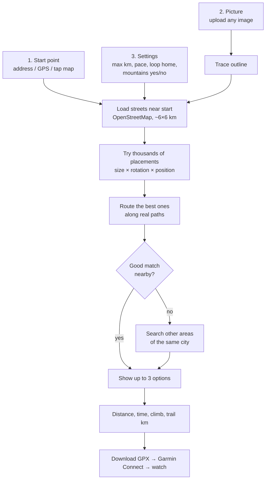

# Route Art

Turn any picture into a running route on real streets, then follow it with a Garmin watch.

The whole app is one file, `index.html`. It runs in the phone's browser and talks to the map services directly. There's no server and no account, and it stores nothing.

## How a route gets made



### 1. Start point
The app asks every time. It never saves or pre-fills a start, so you can start from home one day and a friend's place the next.
- **Address search** uses OpenStreetMap's Nominatim, limited to Korea. OpenStreetMap often lacks Korean building numbers, so if the full address isn't found the app retries with just the road name and says so.
- **Use my location** uses the phone's GPS.
- **Tap the map** to set or fine-tune the start. This always works.

### 2. Tracing the picture
1. Shrink the image to about 220 px.
2. Decide what counts as the shape:
   - If the image has transparency, the opaque part is the shape.
   - If not, Otsu's method picks the light/dark split automatically.
   - If the border comes out mostly "shape", the picture is light-on-dark and gets flipped.
   - The **Swap shape and background** button flips it by hand.
3. Keep only the largest connected blob, so specks and text are ignored.
4. Walk around its outer edge (Moore-neighbour tracing), smooth the pixel staircase (Ramer–Douglas–Peucker), and resample to 400 evenly spaced points.
5. Normalise to a shape with perimeter 1, centred on its middle. From here the shape is just a curve that can be scaled, rotated and moved.

### 3. The mountain question
The **Draw my route** button stays off until the runner answers "Is it okay if the route goes over mountains?" A path counts as a trail when it has:
- `sac_scale`, `trail_visibility` or `mtb_scale` tags (hiking difficulty), or
- an unpaved surface (dirt, ground, rock, gravel…), or
- `highway=path`, `track` or `bridleway` with no surface tag, which in Seoul is almost always a mountain or park trail.

"No" removes those paths from the network entirely. "Yes" keeps them and counts their distance separately, because trail kilometres are slower.

### 4. Loading streets
A single Overpass query fetches every way a runner can use in a 6 × 6 km square around the start: footways, paths, residential streets, park paths, steps, and larger roads. Motorways and trunk roads are never fetched. Ways tagged `foot=no` or `access=private` are dropped. Big roads without a mapped sidewalk get a 25% cost penalty so the router prefers quieter streets. The network is turned into a graph (intersections and the segments between them), and only the largest connected piece is kept, so the route can never get stuck on an island.

### 5. Fitting the picture to the streets
Every combination of these is scored:
- **Size:** perimeter 2.5, 4, 6, 8.5, 11.5, 15 or 19 km, keeping only sizes whose route would fit the distance limit. Routes run about 30% longer than the ideal outline.
- **Rotation:** −30°, −15°, 0°, +15°, +30°, so the picture stays recognisably upright.
- **Position:** a grid of centres around the start, close enough that the start sits inside or near the drawing.

Each placement is scored by the RMS distance from 72 points on the outline to the nearest walkable intersection, capped at 350 m (a spatial grid index makes this fast). Shapes over rivers, rail yards or parks with no paths score badly on their own, and no special water handling is needed. The best placement from each size group (small, medium, large) moves on.

### 6. Routing along the drawing
The outline is cut into waypoints about every 110 m (between 40 and 240 of them). Each waypoint snaps to its nearest intersection, and the app runs A* between consecutive waypoints. The cost of a street segment is its length × (1 + distance from the drawn line ÷ 40 m), so the router hugs the drawing instead of taking shortcuts. Short out-and-back spurs under 160 m that snapping creates are removed afterwards. With **Start and finish at my start point** on, the route runs from the start to the nearest point of the drawing, around it, and back home.

### 7. If it doesn't fit nearby
If the best neighbourhood route matches the picture less than 55%:
1. Ask Nominatim which city the start is in, for example 서울특별시, and get its bounding box.
2. Lay a 5 km grid of candidate areas over the city and try the 5 nearest to the start, loading a 7 × 7 km street square for each.
3. Stop early when one matches 75% or better.

These routes begin on the drawing itself. The app says how far away it is, and that distance isn't counted.

### 8. Scoring and estimates
- **Shape match %** is the average gap between the route and the drawing, measured both ways, compared with the drawing's size. 100% means the route lies exactly on the outline. Options under 40% are hidden.
- **Climb** comes from Open-Meteo's elevation API, sampled every 100 m along the route.
- **Time** uses the trail-running "effort distance" idea: 100 m of climbing counts as 1 extra km, and trail kilometres count 1.25×. Effort distance × your easy pace = estimated time.
- **Options:** up to three clearly different lengths (Compact, Medium, Large), with the best match shown first.

### 9. Getting it onto the watch
The GPX file is a single track with one point per intersection. Garmin Connect turns it into a Course with turn-by-turn and off-course alerts on the Forerunner 265. On phones that support it, a Share button sends the file straight to another app. Naver Map can't import GPX; Strava, Komoot or any GPX viewer can.

## Services used

| What | Service | Limits to respect |
|---|---|---|
| Streets & trails | Overpass API (3 public mirrors, tried in turn) | Fair use; one query per area |
| Address search, city lookup | Nominatim | Max 1 request/second, which a person tapping can't exceed |
| Elevation | Open-Meteo | 100 points per request |
| Map background | CARTO Voyager tiles (OpenStreetMap data) | Free for low-volume, non-commercial use |
| Map library | Leaflet 1.9.4 from cdnjs | none |

All are free and need no key. If the app ever gets lots of users, the public Overpass and Nominatim servers would need to be replaced with self-hosted or paid ones.

## Tests

`tests/run.js` drives the real page in headless Chromium. Every network service is replaced by a fake city: a street grid with a river crossed by a few bridges, a mountain that only has trails, and optionally a lake around the start. It checks:

- a heart fits in the neighbourhood with a ≥ 70% match, ≤ 20 km, and produces a GPX
- streets-only mode uses 0 km of trail
- a lake around the start triggers the city-wide search, which still finds a ≥ 70% match
- a 6 km limit is respected
- the Draw button stays off until the start, the picture and the mountain answer are all given
- no script errors

```
cd RouteArt && npm install && npx playwright install chromium && npm test
```

The GitHub Action `.github/workflows/route-art.yml` runs this on every push that touches `RouteArt/`.

## Launch plan

| # | Step | Who | Status |
|---|---|---|---|
| 1 | App logic: tracing, fitting, routing, city fallback, mountain filter, time estimate, GPX | Claude | Done |
| 2 | Automated tests with a fake city | Claude | Done, 15/15 pass |
| 3 | CI that tests every push and publishes to GitHub Pages | Claude | Done |
| 4 | Merge the branch into the default branch | You (GitHub app or website, tablet is fine) | To do |
| 5 | Turn on Pages once: Settings → Pages → Source → **GitHub Actions**, then re-run the "Route Art" workflow | You (website) | To do |
| 6 | Open `https://junhakwon.github.io/junhakwon/RouteArt/` on your phone and add it to the home screen | You | To do |
| 7 | First real-world check (below) | You | To do |
| 8 | Fix whatever step 7 turns up | Claude | To do |

Pages on a private repository needs a paid GitHub plan. If the repo is private, the alternatives are making it public or hosting the single file anywhere static, like Netlify Drop or Cloudflare Pages, by uploading `index.html`.

### First real-world check
Things the fake city can't prove, in order of risk:
1. **Address search:** does your street resolve? If not, tapping the map works.
2. **Data size and speed:** a 6 × 6 km square of Seoul is roughly 5–15 MB of street data. Check it loads in under ~30 s on mobile data.
3. **Trail detection:** with "No", does it really avoid 관악산-type trails? With "Yes", does it use them?
4. **Accuracy on the ground:** run a short Compact route and compare your Garmin track with the plan. Apartment complexes and gated parks are the likely problem spots, because OpenStreetMap sometimes marks them as open.
5. **Garmin import:** does the GPX import as a Course and navigate on the 265?

## Known limits
- The picture becomes one outline. Inner details, like the eyes of a face, are skipped.
- Thin line drawings work, but the route runs out and back along each line.
- Rotation is limited to ±30° so pictures stay upright.
- Time estimates assume your easy pace. Traffic lights and stairs aren't counted.
- It relies on OpenStreetMap, which is good in Seoul but can mark private complexes as passable.

## Possible next steps
- Let the runner drag, rotate and resize the drawing on the map before routing.
- Draw the picture directly on the map instead of uploading one.
- Elevation-aware fitting that prefers flatter placements.
- A Connect IQ data field that shows "% of drawing complete" on the watch during the run.
