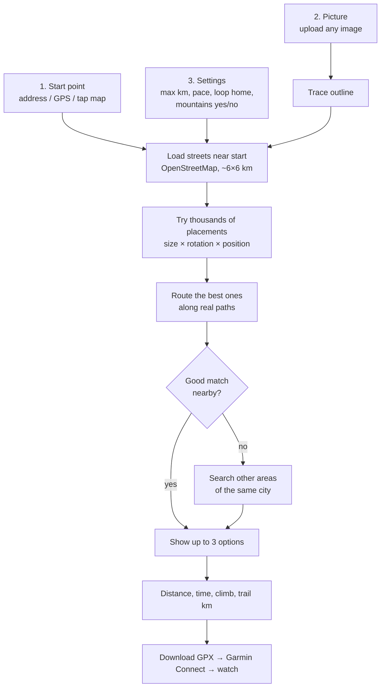

# Route Art

Turn any picture into a running route on real streets, then follow it on your phone or your Garmin watch.

Route Art is an installable web app (PWA). On an iPhone you open it in Safari, tap Share → **Add to Home Screen**, and from then on it has its own icon and opens full screen like any app. It talks to the map services directly from the phone. There's no server and no account, and routes are saved on the phone only.

| File | What it is |
|---|---|
| `index.html` | The whole app: tracing, fitting, routing, Follow mode, My routes |
| `sw.js` | Service worker: lets the app open offline and keeps map tiles along saved routes |
| `manifest.webmanifest`, `icon-*.png` | What the home-screen install uses (name, icon, full-screen) |
| `tools/make-icons.js` | Draws the icons |
| `tests/run.js` | End-to-end tests |

## Using it on an iPhone
1. Open the app link in **Safari** and tap Share → **Add to Home Screen**. The app shows a reminder the first time.
2. Set the start, choose a photo, answer the mountain question, and tap **Draw my route**.
3. Pick an option, then:
   - **Follow on this phone:** a full-screen map with your live position, km done / to go, time left, and an "Off route" warning when you're more than ~35 m from the line. The screen stays on while following (iOS 16.4+).
   - **Share GPX:** opens the iPhone share sheet: Garmin Connect, Files, AirDrop, Komoot, Strava, Gaia GPS…
   - **Download GPX:** saves the file to Files.
4. Following or sharing saves the route to **My routes**, so you can follow or share it again later. The map tiles along it are stored too, so the map still shows on weak signal.

## How a route gets made



### 1. Start point
The app asks every time. It never saves or pre-fills a start, so you can start from home one day and a friend's place the next.
- **Address search** uses OpenStreetMap's Nominatim, limited to Korea. OpenStreetMap often lacks Korean building numbers, so if the full address isn't found the app retries with just the road name and says so.
- **Use my location** uses the phone's GPS.
- **Tap the map** to set or fine-tune the start. This always works.

### 2. Tracing the picture
1. Shrink the image to about 220 px.
2. Decide what counts as the shape:
   - If the image has transparency, the opaque part is the shape.
   - If not, Otsu's method picks the light/dark split automatically.
   - If the border comes out mostly "shape", the picture is light-on-dark and gets flipped.
   - The **Swap shape and background** button flips it by hand.
3. Close 1-pixel gaps, then pick the main subject among the blobs. Each blob is ranked by the area its outer outline encloses, not by its pixel count, because a line-art character is mostly background inside a thin outline. Blobs touching the image edge (phone status bars, black bottom bars, frames) count for only 5%. Specks and text are ignored.
4. Walk around its outer edge (Moore-neighbour tracing), smooth the pixel staircase (Ramer–Douglas–Peucker), and resample to 400 evenly spaced points.
5. Normalise to a shape with perimeter 1, centred on its middle. From here the shape is just a curve that can be scaled, rotated and moved.

### 3. The mountain question
The **Draw my route** button stays off until the runner answers "Is it okay if the route goes over mountains?" A path counts as a trail when it has:
- `sac_scale`, `trail_visibility` or `mtb_scale` tags (hiking difficulty), or
- an unpaved surface (dirt, ground, rock, gravel…), or
- `highway=path`, `track` or `bridleway` with no surface tag, which in Seoul is almost always a mountain or park trail.

"No" removes those paths from the network entirely. "Yes" keeps them and counts their distance separately, because trail kilometres are slower.

### 4. Loading streets
A single Overpass query fetches every way a runner can use in a 6 × 6 km square around the start: footways, paths, residential streets, park paths, steps, and larger roads. Motorways and trunk roads are never fetched. Ways tagged `foot=no` or `access=private` are dropped. Big roads without a mapped sidewalk get a 25% cost penalty so the router prefers quieter streets. The network is turned into a graph (intersections and the segments between them), and only the largest connected piece is kept, so the route can never get stuck on an island.

### 5. Fitting the picture to the streets
Every combination of these is scored:
- **Size:** perimeter 2.5, 4, 6, 8.5, 11.5, 15 or 19 km, keeping only sizes whose route would fit the distance limit. Routes run about 30% longer than the ideal outline.
- **Rotation:** −30°, −15°, 0°, +15°, +30°, so the picture stays recognisably upright.
- **Position:** a grid of centres around the start, close enough that the start sits inside or near the drawing.

Each placement is scored by the RMS distance from 72 points on the outline to the nearest walkable intersection, capped at 350 m (a spatial grid index makes this fast). Shapes over rivers, rail yards or parks with no paths score badly on their own, and no special water handling is needed. The best placement from each size group (small, medium, large) moves on.

### 6. Routing along the drawing
The outline is cut into waypoints about every 70 m (between 50 and 320 of them). Each waypoint snaps to its nearest intersection, and the app runs A* between consecutive waypoints. The cost of a street segment is its length × (1 + distance from the drawn line ÷ 25 m), so the router hugs the drawing instead of taking shortcuts. Short out-and-back spurs under 120 m that snapping creates are removed afterwards. With **Start and finish at my start point** on, the route runs from the start to the nearest point of the drawing, around it, and back home. Those legs are drawn as a faint dotted line and left out of the match score, so they don't muddy the picture.

### 7. Where should the drawing go?
A detailed picture only looks right where the streets happen to run in its shape, so the runner can choose how widely to search:

| Where | What gets tried |
|---|---|
| *Near my start* (default) | A 6 × 6 km square around the start, with the start-and-finish loop. If nothing matches 60%, the app searches the rest of the start's city. |
| A city or district ("Seoul", "마포구") | Its neighbourhoods (`place=suburb/quarter/neighbourhood` in OpenStreetMap), nearest first, then always the one farthest from those already tried, so the whole city is covered quickly |
| A country ("South Korea") | Its cities and towns, biggest population first, at least 20 km apart |
| "The World" | 32 dense, walkable cities with very different street patterns: grids (Manhattan, Barcelona, Chicago), diagonals (Washington, Buenos Aires), organic old towns (Tokyo, London, Seoul, Rome) |

Places are checked 8 at a time, two in parallel (the public map servers allow two requests at once), showing the best match so far. **Check more places** continues through the list. Each place loads a 6 × 6 km square of streets without sidewalks and service roads, which keeps the download small. Results show the top 3 places, each named, with how far it is from the start point if one was set. No start point is needed for a place search.

### 8. Scoring and estimates
- **Shape match %** is the average gap between the drawing part of the route and the picture, measured both ways, compared with the drawing's size (100% minus 4% for every 1% of the radius it's off on average). 100% means the route lies exactly on the outline. Options under 40% are hidden.
- **Climb** comes from Open-Meteo's elevation API, sampled every 100 m along the route.
- **Time** uses the trail-running "effort distance" idea: 100 m of climbing counts as 1 extra km, and trail kilometres count 1.25×. Effort distance × your easy pace = estimated time.
- **Options:** up to three clearly different lengths (Compact, Medium, Large), with the best match shown first.

### 9. Getting it onto the watch and the phone
The GPX file is a single track with one point per intersection, named after the picture (e.g. `heart-11.9-km.gpx`). Garmin Connect turns it into a Course with off-course alerts on the Forerunner 265. Naver Map and Apple Maps can't import GPX, which is why Route Art has its own **Follow** mode.

### 10. Follow mode
The phone's GPS position is projected onto the route to work out how far along you are. The search looks near your last position first, so a route that crosses itself (like the middle of a heart) doesn't jump ahead, and falls back to the whole route if you've moved far. Done is drawn grey, the rest blue. "Off route" triggers past the larger of 35 m and the GPS accuracy (capped at 80 m). Time left = distance left × the pace saved with the route.

### 11. Offline
The service worker caches the app and the map library, so the app opens with no connection. Map tiles the app has shown are kept (up to ~4,000). OpenStreetMap's tile policy forbids bulk pre-downloading, so to have the map on a weak-signal run, open the route in Follow mode once beforehand and scroll along it. Making a *new* route still needs a connection, because the street data comes live from OpenStreetMap.

## Services used

| What | Service | Limits to respect |
|---|---|---|
| Streets & trails | Overpass API (3 public mirrors, tried in turn) | Fair use; one query per area |
| Address search, city lookup | Nominatim | Max 1 request/second, which a person tapping can't exceed |
| Elevation | Open-Meteo | 100 points per request |
| Map background | OpenStreetMap standard tiles | Light use only and no bulk downloading, so only tiles you've viewed are kept offline |
| Map library | Leaflet 1.9.4 from cdnjs | none |

All are free and need no key. If the app ever gets lots of users, the public Overpass and Nominatim servers would need to be replaced with self-hosted or paid ones.

## Tests

`tests/run.js` drives the real page in headless Chromium. Every network service is replaced by a fake city: a street grid with a river crossed by a few bridges, a mountain that only has trails, and optionally a lake around the start. It checks:

- a phone screenshot of a line-art character traces the character, not the black bar along the bottom
- Follow mode shows progress, warns when 300 m off the route, and Share produces a valid GPX
- My routes survives a reopen, and Delete needs a second tap
- the service worker, manifest and icons install correctly, and iPhone Safari shows the Add to Home Screen tip

- a heart fits in the neighbourhood with a ≥ 70% match, ≤ 20 km, and produces a GPX
- streets-only mode uses 0 km of trail
- a lake around the start triggers the city-wide search, which still finds a ≥ 70% match
- a 6 km limit is respected
- "Seoul" with no start point checks named neighbourhoods and returns named options
- "The World" checks cities around the world
- the Draw button stays off until the start, the picture and the mountain answer are all given
- no script errors

```
cd RouteArt && npm install && npx playwright install chromium && npm test
```

The GitHub Action `.github/workflows/route-art.yml` runs this on every push that touches `RouteArt/`.

## Launch plan

| # | Step | Who | Status |
|---|---|---|---|
| 1 | App logic: tracing, fitting, routing, city fallback, mountain filter, time estimate, GPX | Claude | Done |
| 2 | Automated tests with a fake city | Claude | Done, 15/15 pass |
| 3 | CI that tests every push and publishes to GitHub Pages | Claude | Done |
| 3b | iPhone app: home-screen install, Follow mode, share sheet, My routes, offline | Claude | Done, 29/29 checks pass |
| 4 | Merge the branch into the default branch | You (GitHub app or website, tablet is fine) | To do |
| 5 | Turn on Pages once: Settings → Pages → Source → **GitHub Actions**, then re-run the "Route Art" workflow | You (website) | To do |
| 6 | Open `https://junhakwon.github.io/junhakwon/RouteArt/` in Safari on your iPhone, then Share → Add to Home Screen | You | To do |
| 7 | First real-world check (below) | You | To do |
| 8 | Fix whatever step 7 turns up | Claude | To do |

Pages on a private repository needs a paid GitHub plan. If the repo is private, the alternatives are making it public or hosting the single file anywhere static, like Netlify Drop or Cloudflare Pages, by uploading `index.html`.

### First real-world check
Things the fake city can't prove, in order of risk:
1. **Address search:** does your street resolve? If not, tapping the map works.
2. **Data size and speed:** a 6 × 6 km square of Seoul is roughly 5–15 MB of street data. Check it loads in under ~30 s on mobile data.
3. **Trail detection:** with "No", does it really avoid 관악산-type trails? With "Yes", does it use them?
4. **Accuracy on the ground:** run a short Compact route and compare your Garmin track with the plan. Apartment complexes and gated parks are the likely problem spots, because OpenStreetMap sometimes marks them as open.
5. **Garmin import:** does Garmin Connect show up in the share sheet? Does the GPX import as a Course and navigate on the 265?
6. **Follow mode on a real run:** does the blue dot track smoothly, does "Off route" fire at the right times, and does the screen stay on?

## Known limits
- The picture becomes one outline. Inner details, like the eyes of a face, are skipped.
- Thin line drawings work, but the route runs out and back along each line.
- Rotation is limited to ±30° so pictures stay upright.
- Time estimates assume your easy pace. Traffic lights and stairs aren't counted.
- It relies on OpenStreetMap, which is good in Seoul but can mark private complexes as passable.

## Later: App Store version
The plan is to wrap this same code with [Capacitor](https://capacitorjs.com), which turns a web app into a native iPhone app, so nothing here gets rewritten. To keep that easy, the app uses only relative paths, plain browser APIs and no build step. What the native version adds:
- tracking that continues with the screen locked (background location)
- voice cues ("turn left in 50 m")
- appearing as an "Open in…" target for photos
- possibly sending courses straight to the watch through Garmin's Courses API (needs approval from Garmin's developer program)

Needs: an Apple Developer account ($99/year), signing certificates for the macOS GitHub Actions machine, and App Store review.

## Possible next steps
- Let the runner drag, rotate and resize the drawing on the map before routing.
- Draw the picture directly on the map instead of uploading one.
- Elevation-aware fitting that prefers flatter placements.
- A Connect IQ data field that shows "% of drawing complete" on the watch during the run.
